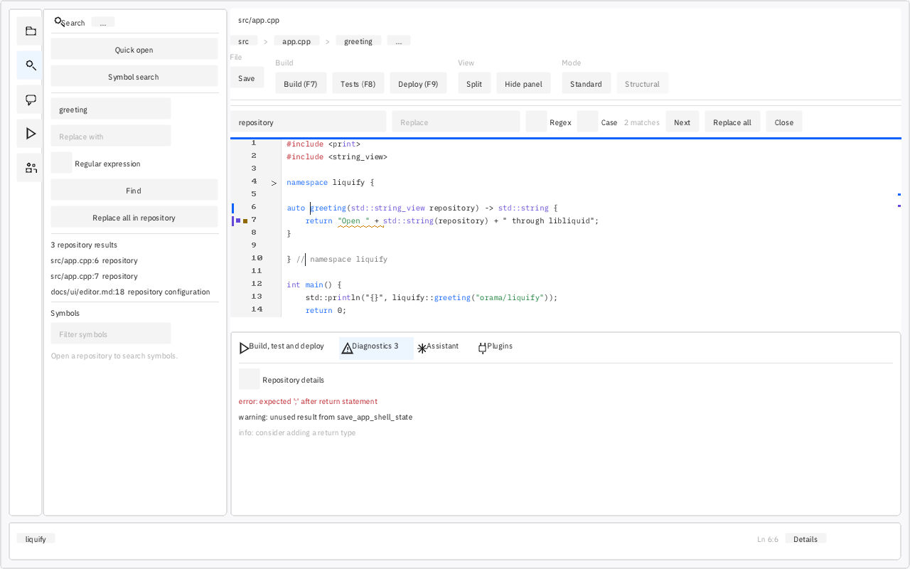

<div align="center">

# liquify

### The IDE for liquid

**A native editor where every save is a signed drip, and the code intelligence<br>
comes from the same graph that builds your repository.**

[**Quickstart**](#quickstart) · [What it does](#what-it-does) · [How it fits](#how-it-fits) · [Known limits](#known-limits) · [Docs](docs/README.md) · [Contributing](#contributing)

`v0.1.0` · experimental · MIT

</div>

<picture>
  <source media="(prefers-color-scheme: dark)" srcset="docs/ui/screenshots/editor-view-dark.png">
  
</picture>

> [!WARNING]
> **Experimental.** v0.1.0 is an early preview, not a tool for daily work. Expect rough edges,
> settings and keymaps that change without notice, and bugs that can lose unsaved work.

## What it does

liquify edits repositories kept in [liquid](https://github.com/oramasearch/liquid). Everything it
knows about files, changes, builds and search comes from libliquid, in one native binary.

| | |
|---|---|
| **Edit** | GPU-drawn text with multi-cursor and column edits, folds, search and replace, and undo per file. Save writes a signed drip; Cut Change names your saved drips as one change. |
| **Navigate** | Quick Open, symbol search, definitions, references, breadcrumbs, back and forward, all from the keyboard. |
| **Understand C and C++** | Diagnostics inline, hover, completion, and structural edits (rename across files, extract function) previewed before they apply. |
| **Build and test** | F7 builds and F8 runs tests through liquid's daemon, with failures shown on the lines they point at. |
| **Work with lake** | Push (F9), request a review, and review in place: inline hunks, comments at the cursor, approve. |
| **Make it yours** | Every key rebindable from one command palette, light and dark themes, searchable settings, native plugins in sandboxed processes. |
| **Optional** | Multiplayer presence and attribution, and an AI assistant that is off by default and opens no connection while off. |

The full list, area by area: [implementation status](docs/design/status.md) ·
[every command and key](docs/ui/commands.md) · [release notes](docs/releases/v0.1.0.md).

## Quickstart

liquify is built from source. On macOS:

```sh
brew install llvm cmake ninja node openssl@3

git clone --recurse-submodules https://github.com/oramasearch/liquid.git
git -C liquid checkout 27d56ba3726f19834dce23125e0e15299f889ba7
git clone --recurse-submodules https://github.com/oramasearch/liquify.git

cd liquify
cmake -S . -B build -G Ninja
cmake --build build
./build/liquify
```

liquid is a sibling checkout, found at `../liquid` (or pass `-DLIQUIFY_LIQUID_SOURCE_DIR`). The
commit above is the one v0.1.0 builds against ([compatibility](docs/build/store-compatibility.md)).
Linux and the other build options: [`docs/build/local.md`](docs/build/local.md).

You land on the front door: open a folder that holds a liquid repository, create one, or clone one
from a lake.

## How it fits

liquify talks only to liquid: libliquid in process for repositories, analysis and edits, and
liquid's daemon for builds and sync. Through liquid it pushes to, pulls from and reviews on a
[lake](https://github.com/oramasearch/lake). It is part of
[Orama Lake](https://github.com/oramasearch/lake-platform), the sovereign AI stack.

## Known limits

- No signed installer yet: build from source.
- Accepted assistant edits are signed as you, not as the assistant acting for you
  ([#74](https://github.com/oramasearch/liquify/issues/74)).
- Plugin sandboxes do not deny reads, and Windows has no network sandbox.
- Quick Open can come up empty now and then, when liquid's index fails to load; fixed in liquid,
  arriving with the next liquid update ([#97](https://github.com/oramasearch/liquify/issues/97)).
- One lake per repository.
- Linux and Windows are exercised less than macOS.

## Contributing

Contributions are welcome: read [CONTRIBUTING.md](CONTRIBUTING.md) and open pull requests against
`dev`. Every contributor signs the [CLA](CLA.md) once. Everyone follows the
[code of conduct](CODE_OF_CONDUCT.md). Bugs and requests go in
[issues](https://github.com/oramasearch/liquify/issues); security reports go privately, per
[SECURITY.md](SECURITY.md).

## License

MIT. See [LICENSE](LICENSE) and [COPYRIGHT](COPYRIGHT); third-party components keep their own
licenses ([THIRD_PARTY_LICENSES](THIRD_PARTY_LICENSES)). "Orama Lake", "liquid", "lake",
"liquify" and their logos are trademarks of OramaSearch, Inc.
