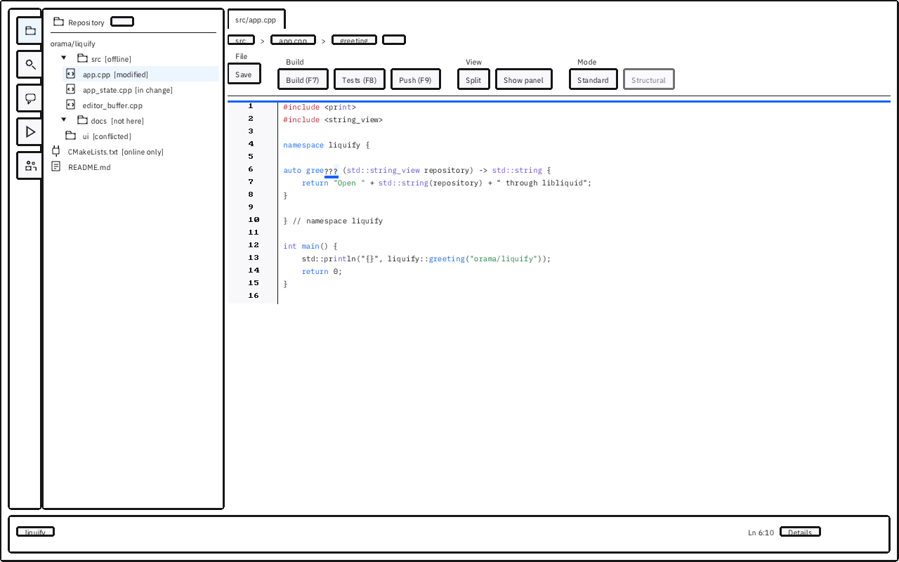
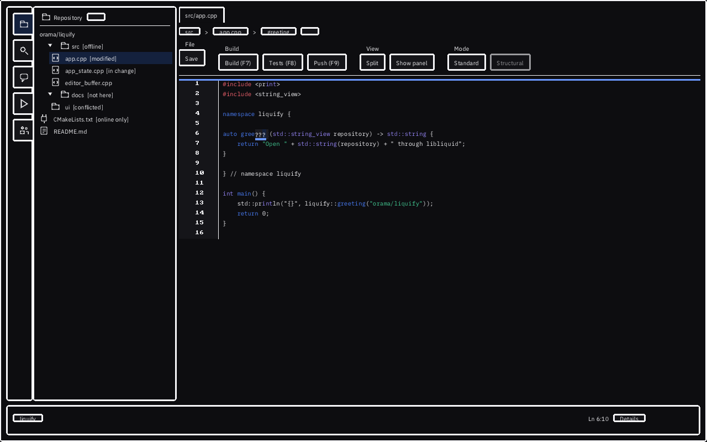

# Input and accessibility

liquify keeps input behavior in the plain-C++ `InputState` model and translates SDL events in
`src/app.cpp`. The model has no SDL or Dear ImGui dependency, so composition, drop routing,
clipboard selection, motion preferences, and accessibility metadata are covered by string and
state-machine tests.

## Text composition

An editor with focus starts SDL text input and supplies the active caret rectangle with
`SDL_SetTextInputArea`. `SDL_EVENT_TEXT_EDITING` updates a retained composition without changing
the buffer. The editor draws that text at the caret and marks the composing selection. A following
`SDL_EVENT_TEXT_INPUT` commits the supplied UTF-8 bytes as one normal editor insertion and clears
the composition. An empty edit, Escape, focus loss, or leaving the editor cancels it.

Composition positions are counted as Unicode codepoints and converted to UTF-8 byte offsets only
for drawing. This supports CJK input methods and dead-key sequences without exposing an incomplete
composition to undo history, analysis, or save. On installed desktop systems, the UI and editor
fonts merge the platform font's common CJK ranges into the embedded IBM Plex faces so composition
and committed text remain visible without exceeding live renderer texture limits.

## Clipboard and file drops

Copy and cut publish `text/plain;charset=utf-8`, `text/plain`, and `text/html`. The HTML form is an
escaped `pre` element with the source path as metadata; the plain forms preserve the selected UTF-8
bytes exactly. Paste prefers plain text. If another application provides only HTML, liquify removes
markup, decodes the common HTML entities, and inserts its text. The native macOS Edit menu exposes
Cut, Copy, and Paste alongside their primary-modifier bindings.

During a desktop file drag, the repository tree and editor show distinct focus-colored outlines.
A drop on the repository tree writes each regular file at the repository root. A drop on the
editor writes each regular file beside the active blob and opens the new blob. Both routes call
libliquid's repository write API, refresh the tree, reject directories and missing files, and
report failures in the editor status. A drop outside either target has no effect.

## Keyboard focus

Dear ImGui keyboard navigation is enabled for the complete shell. Tab and Shift+Tab follow the
rendered order below; activating a control uses Space or Return. When the retained editor owns
focus, Tab returns focus to shell navigation instead of inserting a character. Repository
indentation remains available with primary-modifier+`]`. The editor keeps its arrow, selection,
Home, End, Page Up, Page Down, Backspace, Delete, Return, mode, save, and analysis bindings.

The current control uses the design-system focus color. ImGui controls use the navigation cursor;
the retained editor draws an explicit rectangular focus ring. File-drop targets use the same
visible indication.

Every screen begins with this outer order: Repository, Search, Review, Build, and Multiplayer in
the activity bar; controls in the selected sidebar; editor tabs, toolbar, and source editor; bottom
panel tabs and selected panel controls; status notification actions, Theme, and High contrast;
then visible floating-panel controls.

| Screen | Focus order after the activity bar |
|---|---|
| Welcome | status actions, Theme, High contrast |
| Repository | panel menu, tree rows, editor tab, mode, save, build, tests, push, split, bottom-panel toggle, source editor, bottom tabs, status actions, Theme, High contrast |
| C++ editor | repository controls, editor tab and toolbar, source editor, diagnostics and other bottom tabs, status actions, Theme, High contrast |
| Editor view | search field and results, editor tab and toolbar, source editor, find and replace controls, bottom tabs, status actions, Theme, High contrast |
| Diagnostics | repository controls, editor tab and toolbar, source editor, bottom tabs, diagnostic rows, status actions, Theme, High contrast |
| Build | build sidebar controls, editor tab and toolbar, source editor, bottom tabs, build, test and push actions, status actions, Theme, High contrast |
| Review | review refresh, change and hunk controls, comment controls, approve, editor controls, bottom tabs, status actions, Theme, High contrast |
| Assistant | repository and editor controls, bottom tabs, assistant toggle, prompt, ask, explain, propose, context, accept and reject, status actions, Theme, High contrast |
| Plugins | repository and editor controls, bottom tabs, registered plugin commands, status actions, Theme, High contrast |
| Structural editing | repository controls, structural editor tab, preview actions, bottom tabs, status actions, Theme, High contrast |
| Panel system | repository controls, editor tabs and panel actions, bottom tabs, status actions, Theme, High contrast, floating Assistant controls |
| Settings | search, user or repository scope, group headers, group reset, visible setting controls, Close |
| Accessibility | repository controls, editor tab and toolbar, focused source editor, bottom tabs, status actions, Theme, High contrast |

## Platform accessibility and preferences

On macOS the SDL content view is an accessibility group named `liquify editor`. AppKit
`NSAccessibilityElement` children expose plain-language labels, help text, and group, button, or
text-area roles for the activity bar, registered panels, settings, editor toolbar, source editor,
and theme controls. The children use the same navigation order recorded above. Individual ImGui widgets do
not own native views; their operations remain available through keyboard navigation and the native
menu while the platform tree supplies names and grouping.

High contrast can be toggled from the status bar or with primary-modifier+Shift+H and persists in
repository state version 3. macOS Increase Contrast also enables it. The palette increases text,
border, selected-row, editor-focus, and drop-target contrast while preserving the chosen light or
dark mode.

macOS Reduce Motion is polled at runtime. When enabled, hover and shell transition durations become
zero. The current shell has no scrolling or layout animation, so panel movement, focus, and state
changes are already immediate.

## Verification

`InputState.*` tests cover Japanese composition, dead-key cancellation, UTF-8 positions, both drop
targets, rich and plain clipboard forms, HTML-only paste, reduced motion, and the platform node
names. `AppShellState.*` covers high-contrast persistence and reset. The
`accessibility-light` and `accessibility-dark` screenshots show the high-contrast palette, visible
editor focus, and active Japanese composition; the screenshot pixel test checks both focus colors.

